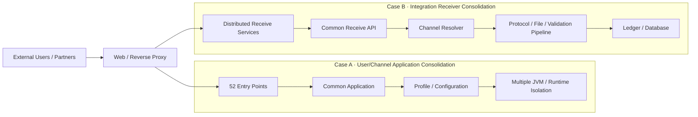

# Financial Application Architecture Portfolio

금융 IT 환경에서 수행한 **Application 통합, Legacy Interface 호환, 운영 안정성 개선 경험**을 Architecture 관점으로 정리한 Engineering Case Study입니다.

> 실제 운영 경험을 기반으로 하되 회사명, 고객사명, 내부 시스템명, IP/Port, URI, DB Schema/Table, 계정, 내부 경로, 로그 및 상세 전문 규격은 공개하지 않거나 일반화했습니다.

## 1. Problem

업무·고객사별로 분산된 Application은 초기에는 장애 격리와 개별 대응이 쉽지만, 업무가 늘어날수록 동일 기능과 운영 절차가 반복되고 변경 영향 분석이 어려워집니다.

이 포트폴리오에서는 서로 다른 성격의 두 통합 사례를 다룹니다.

- **사용자/채널 Application 통합:** 52개 진입점을 4개 업무 영역으로 재구성
- **전자문서 중계 수신 통합:** 업무별 분산 수신 구조를 공통 수신 Application으로 표준화

두 프로젝트 모두 단순히 WAR/JAR 개수를 줄이는 것이 아니라 다음 원칙을 공통으로 적용했습니다.

- 외부 Interface Compatibility 유지
- 공통 로직과 업무별 설정 분리
- 장애·재기동·Scale-out 단위 고려
- Thread / Connection / DB / File I/O 영향 검토
- 운영자가 추적·재처리할 수 있는 구조 확보
- 운영 전 자동 Build/Test 및 배포 Artifact 무결성 검증

## 2. Architecture



상세 비교는 [Application Architecture Integration](docs/application-architecture-integration.md)을 참고하세요.

## 3. Key Design Decisions

### Preserve external interfaces, replace internal structure

운영 중인 금융 시스템에서는 외부 호출 경로를 동시에 변경하면 Application 전환과 Interface 변경 위험이 겹칩니다. 따라서 Web/Reverse Proxy 계층에서 기존 진입점을 유지하고, 내부 Application 구조를 단계적으로 교체하는 방식을 우선했습니다.

### Separate configuration from common logic

업무별 차이가 코드 분기로 증가하지 않도록 환경·업무 식별값을 Configuration으로 분리했습니다. 공통 인증, 업로드, 전문 수신, 파일 처리, 상태 관리 등은 하나의 처리 흐름으로 유지하고 실제 차이는 Profile/Channel 설정으로 주입하도록 설계했습니다.

### Integration must not destroy isolation

Application을 하나로 합치는 것만으로 통합 성공으로 판단하지 않았습니다. Runtime/JVM, Thread Pool, Connection Pool, 배포·재기동 범위와 장애 영향도를 함께 검토해 필요한 격리 단위를 남겼습니다.

### Validate the deployable artifact, not only source code

Git 기반 변경관리와 함께 Build/Test Gate를 두고 실행 JAR의 SHA-256을 생성해, 폐쇄망에 반입된 Binary가 CI에서 검증한 Artifact와 같은지 확인할 수 있는 절차를 구성했습니다.

## 4. Case Studies

### Case A · 52 Entry Points → 4 Business Areas

중복된 고객사·서비스 진입점을 기능 책임 기준으로 4개 영역으로 정리하고, 단일 소스/배포 구조와 환경별 설정 분리를 적용했습니다.

핵심 판단은 “업무별 WAR를 늘리면 배포·스크립트·Alias·DB 코드 관리가 다시 증가한다”는 점이었습니다. 따라서 공통 WAR와 Profile 기반 설정을 유지하면서 Runtime을 분리해 업무별 선택적 배포·재기동이 가능하도록 구성했습니다.

상세: [Portfolio Summary](docs/portfolio-summary.md)

### Case B · Distributed Receiver → Common Integration Application

업무별로 분산된 전자문서 수신 서비스를 하나의 공통 수신 구조로 재설계했습니다.

Binary 전문, 고정길이 Header, Archive, XML Metadata, 관계형 DB 원장을 다루는 Legacy 처리 흐름을 분석하고 Spring Boot/JPA 기반으로 재구성했습니다. 외부 호출 경로는 Reverse Proxy에서 유지하고 내부에서는 명시적인 Channel Code로 업무를 식별했습니다.

추가로 Binary Streaming, Archive Path Traversal 방어, XML XXE 방어, Transaction Boundary, Legacy Response 호환, CI Artifact 검증까지 함께 설계했습니다.

상세: [Receiver Modernization](docs/receiver-modernization.md)


### Case C · Bulk Document Export / Delivery

대량 문서 조회·출고 API에서는 최대 10,000건의 CSV/Excel/JSON 요청 등록, Request Key 기반 처리 추적, 분할 Archive 생성, 상태/파일개수/다운로드 API를 하나의 흐름으로 설계했습니다.

초기에는 등록 자체를 별도 비동기 Job으로 분리하는 방안을 검토했지만, 품질 환경에서 10,000건 등록이 약 38초에 정상 응답되는 것을 확인한 뒤 **측정 결과를 기준으로 즉시 구조를 복잡하게 만들지 않고 기존 동기 등록 구조를 유지**했습니다. 대신 이후 처리 단계는 작업 상태와 결과 파일을 분리해 장시간 작업을 추적할 수 있도록 했습니다.

상세: [Bulk Document Export Portfolio](https://github.com/Yohanesty/bulk-document-export-portfolio)

## 5. Validation

설계 변경은 코드 컴파일만으로 완료 처리하지 않고 다음 계층을 구분해 검증합니다.

```text
Client
→ Web / Reverse Proxy
→ Security
→ Controller / Protocol
→ Thread / Connection
→ File / XML
→ Transaction
→ Database
→ Response Compatibility
→ Deployment Artifact
```

세부 체크리스트: [Production Validation](docs/production-validation.md)

## 6. Result

- 52개 진입점을 4개 업무 영역으로 재구성해 중복 Application 관리 포인트를 축소
- 업무별로 분산된 수신 흐름을 공통 Integration Pipeline으로 표준화
- 외부 Interface를 유지하면서 내부 Architecture를 교체하는 전환 방식 적용
- 설정과 소스 로직을 분리해 신규 업무 추가 시 중복 구현을 최소화
- Runtime/배포/재기동 단위를 고려해 통합에 따른 장애 영향 확대를 제어
- Binary/File/XML/DB를 포함한 End-to-End 수신 흐름의 검증·추적 구조 강화
- CI Build/Test와 Binary SHA-256 검증을 연결해 폐쇄망 배포 Artifact 추적성 확보

> 성능 개선율, 장애율 감소율, MTTR 등 측정하지 않은 KPI는 성과로 주장하지 않습니다.

## 7. Related Portfolio

- [Bulk Document Export Portfolio](https://github.com/Yohanesty/bulk-document-export-portfolio) — 최대 10,000건 등록, Request 추적, 장시간 Job, 분할 Archive 및 다운로드 Architecture
- [Financial E-Document Gateway Portfolio](https://github.com/Yohanesty/financial-edoc-gateway-portfolio) — Legacy native/socket 기반 전자문서 수신 구조를 Java/Netty 기반으로 현대화한 별도 사례
- [Spring Security MFA Portfolio](https://github.com/Yohanesty/spring-security-mfa-portfolio) — Legacy Spring Web 인증 구조에 TOTP MFA를 확장한 보안 개선 사례
- [Zabbix Monitoring Portfolio](https://github.com/Yohanesty/zabbix-monitoring-portfolio) — 서버·Application 통합 모니터링 및 운영 자동화 사례

## 8. Repository Structure

```text
.
├── README.md
├── SECURITY.md
├── NOTICE.md
└── docs/
    ├── portfolio-summary.md
    ├── architecture-one-pager.md
    ├── application-architecture-integration.md
    ├── receiver-modernization.md
    ├── bulk-document-export.md
    └── production-validation.md
```

## Security Notice

이 저장소에는 공개 가능한 Architecture 설명만 포함합니다. Production IP/Hostname/Port, 실제 URI·전문 규격, DB Schema/Table, 계정/비밀번호/Key, 내부 경로, 실제 로그 및 고객 데이터는 포함하지 않습니다.
