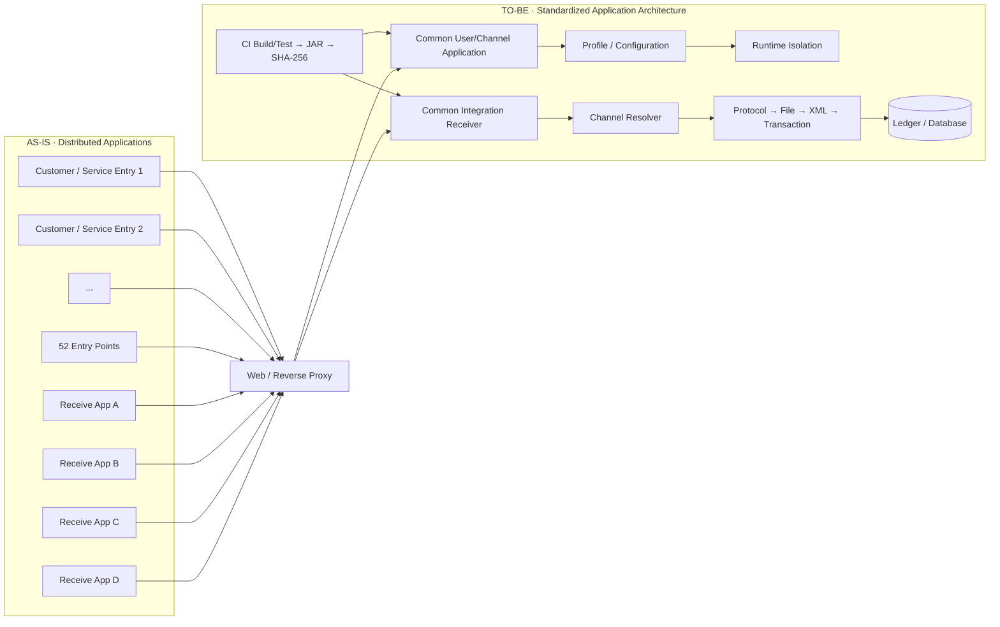

# Application Architecture Integration · One Pager

> Application 통합 사례의 핵심 설계와 의사결정을 한 장으로 요약한 Architecture 문서입니다.

## AS-IS → TO-BE



## 핵심 변화

| 관점 | AS-IS | TO-BE |
|---|---|---|
| Application | 고객사/업무별 분산 | 기능 책임 중심 공통화 |
| Interface | Application과 강결합 | Web/Proxy에서 Legacy Interface 유지 |
| 업무별 차이 | 코드 분기·복제 | Profile / Channel Configuration |
| 배포 | 다수 프로젝트/운영 포인트 | 공통 Artifact + 필요한 Runtime 격리 |
| 수신 처리 | 업무별 중복 흐름 | Protocol/File/XML/DB 공통 Pipeline |
| 장애 분석 | Application별 개별 확인 | Layer별 추적 + 수신 상태 관리 |
| 품질 Gate | 수동 Build 중심 | CI Build/Test + Artifact SHA-256 |

## Architecture 판단 기준

```text
통합 효과
    + 중복 코드 감소
    + 변경 포인트 축소
    + 신규 업무 확장 용이

반드시 같이 검토
    - 장애 영향 범위
    - Thread / Connection Pool 공유
    - 배포 / 재기동 단위
    - Scale-out 단위
    - Transaction / 재처리
```

## 한 문장 설명

**“Legacy Interface는 유지하면서 분산 Application의 공통 기능을 표준화하고, Configuration과 Runtime Isolation으로 업무 차이와 장애 범위를 분리했습니다.”**
