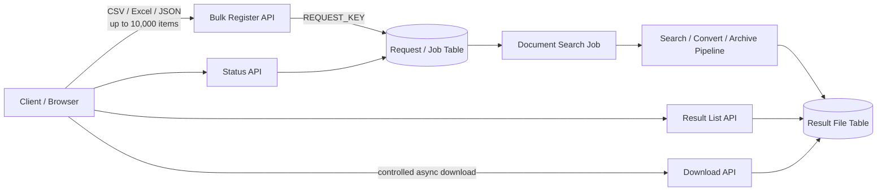

# Bulk Document Export & Delivery Architecture

## 1. Problem

대량 문서 조회·출고 기능에서는 단건 API와 달리 다음 문제가 동시에 발생합니다.

- CSV / Excel / JSON으로 최대 10,000건을 한 번에 등록
- 등록 이후 장시간 문서 조회·변환·압축 처리
- 한 번의 요청에서 여러 Archive 결과가 생성될 수 있음
- 사용자는 현재 처리 상태와 결과 파일 개수를 알아야 함
- 브라우저에서는 여러 결과 파일을 한 번에 내려받고 싶음
- 일부 API는 Body Token, 일부 API는 Bearer Token을 사용해 Request Model 충돌 가능

기술 스택은 Spring 4 / MyBatis / Oracle 기반의 기존 운영 환경을 유지하면서 개선했습니다.

## 2. Architecture



## 3. Registration Decision

초기 설계에서는 10,000건 요청 등록 자체를 별도 비동기 Job으로 분리하는 방안을 검토했습니다.

그러나 품질 환경에서 실제 10,000건 등록을 실행했을 때 **약 38초에 정상 등록과 HTTP 응답까지 완료**되는 것을 확인했습니다.

따라서 다음과 같이 판단했습니다.

```text
Measured Result
10,000 items
→ about 38 seconds
→ normal response

Decision
즉시 비동기 등록 구조로 재설계하지 않음
→ 기존 동기 등록 유지
→ 이후 장시간 처리만 Job/Status 기반으로 추적
```

핵심은 “대량이면 무조건 비동기”가 아니라 **실측된 처리시간, Timeout 정책, 운영 복잡도를 같이 보고 구조 변경 여부를 결정**한 것입니다.

운영 반영 시에는 Web/WAS/Proxy Timeout과 DB 부하를 별도로 확인해야 하며, 데이터 증가로 등록 시간이 임계값을 넘기 시작하면 Register Job 분리를 다시 검토할 수 있도록 경계를 유지했습니다.

## 4. Request Tracking

대량 요청은 개별 문서 ID가 아니라 요청 단위의 `REQUEST_KEY`를 기준으로 추적하도록 구성했습니다.

```text
Client Request
    ↓
REQUEST_KEY
    ↓
Bulk Registration
    ↓
DOCUMENT_SEARCH Job
    ↓
Result Files
```

이를 통해 사용자는 하나의 Request Key로 다음 정보를 조회할 수 있습니다.

- 등록 여부
- 작업 상태
- 처리 완료 여부
- 생성된 Archive 개수
- 다운로드 가능한 결과 목록

## 5. Result File Separation

대량 문서는 하나의 Archive로 만들지 않고 파일 크기·처리 단위에 따라 여러 결과 Archive가 생성될 수 있도록 결과 정보를 별도 테이블로 관리했습니다.

```text
Request
  └─ Result File 1
  └─ Result File 2
  └─ Result File 3
  ...
```

이를 통해 작업 상태와 실제 결과 파일을 분리하고, 재조회 시 Archive 파일 수와 다운로드 대상을 명확히 확인할 수 있게 했습니다.

## 6. Browser Full Download

사용자 요구사항은 “전체 다운로드 버튼 한 번으로 모든 결과 파일을 받는 것”이었습니다.

브라우저에서 하나의 HTTP 응답에 여러 파일 다운로드를 직접 묶는 대신 다음 흐름을 적용했습니다.

```text
[전체 다운로드 클릭]
        ↓
[Result List API]
        ↓
[다운로드 대상 목록]
        ↓
[Async Download Requests]
        ↓
[각 Archive 다운로드]
```

무제한 동시 요청보다는 브라우저/서버 부하를 고려해 제한된 동시성으로 요청하는 구조가 적합합니다.

이 방식은 Server-side에서 다시 대형 ZIP을 재생성하는 추가 I/O를 피하면서 이미 생성된 Archive를 그대로 전달할 수 있다는 장점이 있습니다.

## 7. Authentication Request Model Separation

외부 API 중 일부는 Token을 Request Body로 받고, 다른 API는 HTTP `Authorization: Bearer` Header로 받았습니다.

동일한 Request 명칭을 재사용하면 API별 의미가 섞이기 때문에 Request Model을 역할별로 분리했습니다.

예:

```text
BodyTokenRequest
BearerTokenRequest
DocumentSearchRequest
DownloadRequest
```

Protocol 차이를 DTO 이름과 경계에 명시해 Controller/Service에서 인증 전달 방식이 혼재되지 않도록 했습니다.

## 8. Architecture Decisions

### Synchronous registration was retained based on measurement

10,000건이라는 숫자만 보고 비동기화를 결정하지 않고 실제 수행시간을 측정한 후 구조 변경 여부를 판단했습니다.

### Long-running work is tracked separately

등록 API가 모든 문서 조회·변환·압축이 끝날 때까지 Connection을 점유하지 않도록 실제 장시간 작업은 Job/상태 기반으로 분리했습니다.

### Request state and output files are separate concepts

작업 상태와 결과 파일 목록을 한 테이블/응답에 억지로 결합하지 않고 각각의 Lifecycle로 관리했습니다.

### Reuse generated artifacts

전체 다운로드를 위해 서버가 기존 Archive들을 다시 하나의 초대형 파일로 압축하지 않고 이미 생성된 결과 파일을 목록 기반으로 다운로드하도록 했습니다.

## 9. Validation

확인 항목:

- 1 / 10 / 100 / 1,000 / 10,000건 등록
- Web / WAS / Proxy Timeout
- DB Insert 수행시간과 Transaction 범위
- 동일 REQUEST_KEY 중복 처리
- Job 상태 전이
- 결과 파일 개수 일치
- 분할 Archive 생성 실패
- 다운로드 중 일부 파일 실패
- Browser 동시 다운로드 요청 수
- Body Token / Bearer Token API 분리
- 재조회 / 재다운로드 가능 여부

## 10. Result

- 최대 10,000건 Bulk Request 등록 Interface 구성
- REQUEST_KEY 기반 장시간 작업 추적 구조
- 문서 조회·변환·분할 Archive 생성 Pipeline 구성
- 상태 / 결과 파일 개수 / 파일 다운로드 API 분리
- 목록 기반 전체 다운로드 흐름 구성
- 서로 다른 Token 전달 방식의 Request Model 분리
- 실측 결과를 근거로 불필요한 비동기 등록 재설계를 보류

> 10,000건 약 38초는 특정 품질 테스트 환경에서의 측정값이며 일반적인 성능 보장값으로 사용하지 않습니다.
