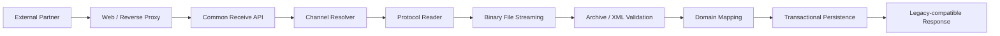

# Integration Receiver Modernization

## Problem

업무별로 분산된 전자문서 수신 Application은 고정길이 Binary 전문, 파일 수신, Archive 해제, XML Metadata 분석, DB 원장 등록이라는 유사한 처리 흐름을 각각 구현하고 있었습니다.

이 구조에서는 기능 변경이나 보안 보완 시 동일한 변경을 반복해야 하고, 장애 분석과 재처리 방식도 Application별로 달라질 가능성이 있었습니다.

## Architecture



## Key Decisions

- Legacy Endpoint는 Proxy에서 유지하고 내부 API만 표준화
- 업무 식별값은 소스 분기보다 Channel Configuration으로 관리
- 대용량 파일은 Request 전체 적재 대신 Stream 방식으로 저장
- Archive Path Traversal과 XML XXE 방어 적용
- Legacy DAO를 JPA Composite Key / Sequence 구조로 재설계
- DB 등록 완료 전에는 전체 성공으로 처리하지 않는 상태 흐름 구성
- Legacy 응답 전문은 고정길이와 Offset을 자동 테스트 대상으로 관리
- CI에서 Build/Test/JAR/SHA-256을 생성해 배포 Binary 정합성 확인

## Validation

```text
Reverse Proxy Route
→ Content-Type
→ Security Filter
→ Binary Header
→ File Size
→ Archive Extract
→ XML Metadata
→ Database Transaction
→ Response Length / Offset
```

## Result

분산되어 있던 수신 기능을 하나의 표준 Pipeline으로 통합할 수 있는 구조를 만들고, 신규 업무 추가 시 Application 복제보다 Channel/Configuration 확장을 우선할 수 있게 했습니다.

운영 적용 전에는 실제 Legacy 정상/오류 응답과 신규 응답의 byte-for-byte 비교, 실DB 원장 등록, 이중화/Failover, 중복수신·멱등성 정책을 추가 검증 대상으로 관리합니다.
